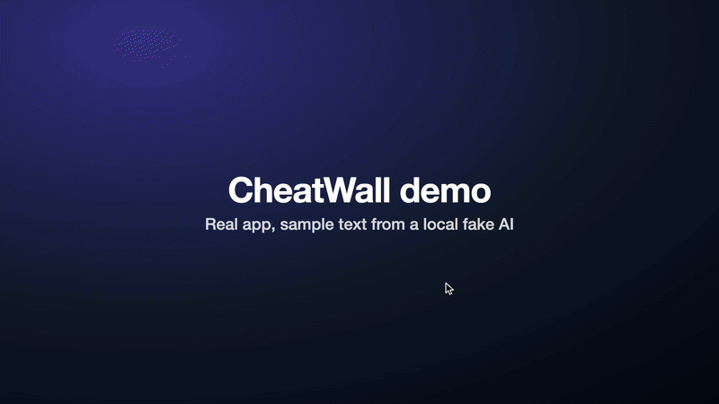

# CheatWall

CheatWall uses AI to make big, print-ready cheat sheet posters for any topic you study. You type a topic, and you get an A2 poster as a PDF and a PNG.



*Demo of the real app. The poster text comes from the local fake AI provider, not a real model.*

Intro page and install guide: https://abozaralizadeh.github.io/CheatWall/

Source available, free for non-commercial use (PolyForm Noncommercial 1.0.0). See [License](#license).

"CheatWall" is a working name.

## Status

Early. The site, job queue, limits, poster layout and PDF export all work and are tested. The poster text comes from a local fake provider with sample data, so real AI quality and cost are not measured yet. The Anthropic provider is written but has only run against a mocked client. Nothing here has been deployed.

## How it works

1. You send a topic, and optionally a level.
2. The server checks your limit and the daily spend cap.
3. A background job checks the topic, writes the poster as structured data, and reviews it in a second pass.
4. Our templates draw the poster. A headless Chrome fits it to one page and exports a PDF and a PNG.

The AI only writes data. An image model never draws words. Topics and AI output are untrusted, so everything is escaped and the poster is rendered in a browser with no network.

## Quick install

You need Node 24 or newer and a Chrome or Chromium (found automatically, or set `CHROME_PATH`).

```bash
git clone https://github.com/abozaralizadeh/CheatWall.git
cd CheatWall
npm install
cp .env.example .env
npm start
```

Open http://127.0.0.1:3000. The default provider is the local fake: it needs no key and costs nothing. It has handwritten posters for SQL, Spanish verbs and organic chemistry, and a labelled placeholder for any other topic.

To try a real model, set `PROVIDER=anthropic` and `ANTHROPIC_API_KEY` in `.env`. Keep `DAILY_CAP_CENTS` low for the first runs.

Other commands:

```bash
npm run poster -- "SQL" --theme midnight   # topic in, PDF and PNG out in ./out
npm run phase1                             # ten topics, writes docs/PHASE1-RESULTS.md
npm run typecheck
```

## Run the tests

```bash
npm test
```

79 tests, about 5 minutes, because some of them drive a real browser.

## Run it on a VM

```bash
sudo ./setup_service.sh                                   # first run installs, later runs update and restart
sudo CHEATWALL_DOMAIN=example.com -E ./setup_service.sh   # also sets up Caddy for HTTPS
journalctl -u cheatwall.service -f                        # live logs
```

A rotating log file (10 MB x 5) is kept in `/var/lib/cheatwall/logs/`. Secrets live in `/etc/cheatwall/cheatwall.env`, never in the repo. `.env.example` lists every setting. The script has not been run on a real VM yet, so read it before you use it.

## What is real and what is faked

| Part | State |
| --- | --- |
| Site, job queue, SQLite, limits, daily spend cap, expiry, logs | Real, tested |
| Poster templates, fit to page, A2 PDF and PNG, three themes | Real, tested with a real Chrome |
| Text provider | Fake by default (`PROVIDER=fake`) |
| Anthropic provider (`src/ai/anthropic.ts`) | Written, tested only against a mocked client |
| `setup_service.sh`, `.vscode` config | Written, not run on a VM or opened in VS Code |
| Privacy, terms, about pages | Templates with `[placeholders]`. Fill them in and have them reviewed before you run a public site |

## Docs

- [docs/DESIGN.md](docs/DESIGN.md): architecture and the reason for each decision
- [docs/LOGICAL-FLOW.md](docs/LOGICAL-FLOW.md): the main flows
- [docs/OPEN-WORK.md](docs/OPEN-WORK.md): known issues and what is left
- [demos/README.md](demos/README.md): how the demo was recorded
- [docs/PHASE1-RESULTS.md](docs/PHASE1-RESULTS.md): the ten-topic layout test with the fake provider

Code layout: `src/` (server, jobs, store, limits, `ai/`, `render/`), `public/` (the site), `scripts/`, `tests/`. Node runs the TypeScript directly, so there is no build step. Don't use enums or `constructor(private x)` parameter properties, because type stripping doesn't support them.

## Contributing

See [CONTRIBUTING.md](CONTRIBUTING.md). Short version: open an issue before a big change, run `npm test` and `npm run typecheck`, never commit real keys, and know that contributions are accepted only if you agree that Abozar Alizadeh may relicense them, commercial use included.

## License

Source available, free for non-commercial use under the [PolyForm Noncommercial License 1.0.0](LICENSE). You can use, study and change it for non-commercial purposes. Commercial use needs written permission: ask by opening a GitHub issue. This is not an open source licence, because it does not allow commercial use.

Third-party packages keep their own licences, listed in [THIRD_PARTY_NOTICES.md](THIRD_PARTY_NOTICES.md).
