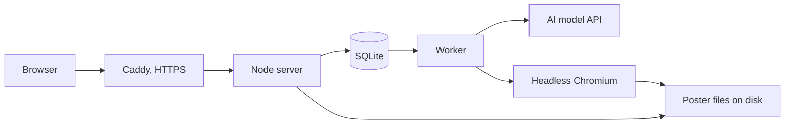

# Design

This covers how the first version is built and why. Choices here can change, so each one comes with its reason.

## Overview

One web app on one Linux VM. The AI writes the poster's text as structured data. Our own templates turn that into the poster, and a headless browser exports it to PDF and PNG.



The worker runs inside the same service as the app and takes jobs from SQLite, two at a time. That's enough at this size, and it can move to its own process later without a redesign.

## Tech stack

| Part | Choice | Why |
| --- | --- | --- |
| Language | TypeScript, run directly by Node 24 | One language for site, worker and templates, and no build step |
| Web app | Plain Node (`node:http`), static HTML and small JS files | Changed from the first plan (Next.js). Fewer dependencies, strict CSP with no inline scripts, nothing to build |
| Database | SQLite through Node's built-in `node:sqlite` | No extra server, no native module to compile, easy to back up, fine for one VM |
| Validation | Zod | One definition for the content format, in code and for the AI's output |
| Text AI | Azure OpenAI with a fallback deployment, or Claude Opus 5.5 (`claude-opus-5-5`), both with structured outputs | Strong on accuracy and on returning data in an exact shape. Cheaper models can be compared later |
| Poster drawing | HTML and CSS templates | Best typography for the effort, and easy to theme |
| Export | Playwright with Chromium | Vector PDF with real text, plus PNG |
| Formulas and code | KaTeX for formulas, plain monospace for code | KaTeX renders on the server. Code highlighting (Shiki) is left for later |
| Fonts | Open licence fonts, stored in the project | No outside requests, safe to embed in PDFs |
| Web server | Caddy on a VM of its own, or an existing nginx on a shared VM | Caddy gives automatic HTTPS with a simple config. On a shared VM the nginx that is already there stays in charge |
| Hosting | One VM with 2 vCPUs and 4 GB RAM, in the EU | Cheap, and Chromium needs the memory |
| Running it | systemd, set up by `setup_service.sh` | Same script for first install and updates |

## Data model

### `posters`

| Field | Type | Notes |
| --- | --- | --- |
| `id` | text | Long random value, also the private link |
| `topic` | text | Up to 120 characters |
| `level` | text | `beginner`, `student`, `advanced` or empty |
| `theme` | text | One of three themes |
| `status` | text | `queued`, `checking`, `writing`, `reviewing`, `rendering`, `ready`, `refused`, `failed`, `expired` |
| `content` | JSON | Poster content, below |
| `message` | text | Reason shown if refused or failed |
| `visitor_hash` | text | Salted daily hash, for the limit |
| `model` | text | Which AI model made it |
| `input_tokens` | integer | For cost tracking |
| `output_tokens` | integer | For cost tracking |
| `cost_cents` | real | Worked out from tokens |
| `created_at` | datetime | |
| `expires_at` | datetime | 30 days after creation |

### `daily_usage`

| Field | Type | Notes |
| --- | --- | --- |
| `day` | date | Primary key |
| `posters` | integer | Posters made |
| `cost_cents` | real | Compared with the daily money cap |
| `tokens` | integer | Input plus output tokens, compared with `DAILY_TOKEN_BUDGET` |
| `requests` | integer | AI calls, compared with `DAILY_REQUEST_CAP` |

### Files

Stored under `data/posters/<id>/`: one PDF and one PNG for each theme used. They can be redrawn from `content`, so nightly backups only need the database.

### Poster content

```json
{
  "title": "Organic Chemistry",
  "subtitle": "Reactions, groups and mechanisms",
  "sections": [
    {
      "heading": "Functional groups",
      "kind": "table",
      "columns": ["Group", "Formula", "Example"],
      "rows": [["Alcohol", "R-OH", "Ethanol"]]
    }
  ],
  "note": "Extra note for health, legal or financial topics, if needed"
}
```

Section kinds are `points`, `table`, `steps`, `definitions`, `formulas` and `code`. Each has a limit on length, so one section can't swallow the page.

## Site routes

| Route | What it does |
| --- | --- |
| `POST /api/posters` | Checks input and limits, creates the poster, returns its id |
| `GET /api/posters/:id` | Returns status and message |
| `POST /api/posters/:id/theme` | Switches theme, no AI call |
| `GET /api/posters/:id/poster.pdf` | Downloads the PDF |
| `GET /api/posters/:id/poster.png` | Downloads the PNG |
| `GET /api/health` | Health check for setup and monitoring |

## Screens

| Screen | Purpose |
| --- | --- |
| Home | Topic box, level, a few sample posters |
| Working | Live progress on the poster's own link, 1 to 2 minutes |
| Poster | Preview with zoom, theme switch, download PDF and PNG, make again, AI note |
| Refused | Plain reason, try another topic |
| Failed | Apology, try again, doesn't count against the limit |
| Limit reached | Your limit or the daily cap, when to come back |
| Expired | Poster is gone, make it again |
| Privacy, Terms, About | Legal pages and how the site works |

All screens work on a phone. The poster itself is made for print, so on a phone people pan and zoom.

## Security

- Topics and AI output are untrusted. A topic can try to steer the AI, and content can contain anything.
- All content goes through the template's escaping, with no raw HTML from the AI.
- KaTeX runs with its trust setting off.
- The renderer runs Chromium with four separate locks: every connection goes to a dead proxy (loopback included), the browser context is offline, every request that is not a `data:` URL is refused, and the page carries a CSP with `default-src 'none'`. One layer alone is not enough: `navigator.sendBeacon` slips past request blocking by itself, which a repeat test caught.
- Rendering has two steps. A measuring page runs our own fit script (no AI text is ever a script) and takes the PNG. The PDF comes from a second page with JavaScript switched off.
- Topics go to the model in a clearly marked data block, and the structured format limits what can come back.
- The API key lives in the service's environment file on the VM, readable only by the service.
- The private link uses at least 128 bits of randomness. Pages send a no-index header.

## Logging

- Logs go to journald, visible with `journalctl -u cheatwall.service -f`.
- A copy goes to `logs/cheatwall.log`, rotated at 10 MB with 5 files kept, so it can be copied off the VM.
- Logs hold poster ids, stages, timings and errors. No IP addresses.

## Key decisions

| Decision | Reason |
| --- | --- |
| AI writes structured data, templates draw the poster | Image models garble text. This way every word is sharp, editable later, and printable at any size |
| No images in the first version | Good typography can carry a cheat sheet, and it keeps cost and risk down. Any later images must contain no text |
| Second AI pass reviews the content | Catches many mistakes at a modest cost. It doesn't prove the content is right, so every poster keeps its "check this" note |
| No source citations in the first version | Model-written citations can be made up. Fake sources are worse than none |
| Refuse unsafe topics before writing | "Every topic" still needs a line, and checking first avoids paying to write something we'd throw away |
| A2 portrait PDF | Big enough to read from a desk or a wall, and a vector PDF scales to other sizes |
| Three themes on one layout | Beauty is the point of the product, but one excellent layout beats five average ones |
| No accounts | Fastest route to a poster and the least personal data. Limits work without them |
| Private links, no public gallery | Avoids moderating public content early on |
| Delete posters after 30 days | Keeps storage and stored data small. Anyone can make one again |
| Hard daily spend cap | A free AI site can run up a big bill overnight. The cap makes the worst day known in advance |
| Daily salted IP hash for limits | Enough to stop one person using up the cap, with no long-term tracking |
| Status polling, not streaming | A job takes a minute or two and has a few stages. Polling survives closed tabs and restarts with less code |
| One Node service with SQLite | One VM, one process and one script to run. Easy to split later if traffic ever calls for it |
| AI provider behind one small module | Models and prices change often, so swapping should be a small change |
| No diagrams on posters in the first version | Diagrams on posters are hard to lay out well, so they wait until the core poster is proven |

## What this design doesn't try to do

Handle heavy traffic, keep posters for good, or guarantee the content is right. Each of those is a later decision.

## Changes made while building

| Change | Reason |
| --- | --- |
| Plain Node instead of Next.js | See the tech table. Fewer moving parts for a one-VM site |
| Fit step also checks tables, code and formulas | A four-column table with long words used to spill out of its card and still count as "fits". Now each table gets its own text size, and the poster only shrinks if that is not enough |
| Spacing grows only up to a cap | Very thin content (under about 15 lines) still leaves white space. Real AI output should aim at 7 to 10 sections |
| Sections cannot split across columns | Keeps cards whole, but one column can end shorter than the others. Known look issue to judge with real posters |
| The AI provider returns `unknown` and the pipeline validates | A provider can never skip validation |
| The sensitive-topic note is added by the pipeline, not by the AI | The wording stays the same whatever the model does |
| A local fake provider exists | It needs no key and costs nothing. It gives handwritten sample posters, so real AI quality and cost are unmeasured |
| Azure OpenAI provider, with a fallback deployment | It runs on an Azure account that already exists. If the main deployment is busy, down or missing, the same request goes to the fallback. A refusal or a bad answer never goes to the fallback, so a poster can't quietly cost twice. Plain `fetch`, no new dependency |
| Prompts live in one shared module | Every provider asks for exactly the same thing, so switching models doesn't change the poster |
| Three daily caps (money, tokens, AI requests), checked before every AI call | Prices per model are easy to get wrong. Tokens and request counts don't depend on a price table, so the worst day stays bounded even if the price settings are off. A job that's already running stops at its next AI call once a cap is spent |
| The site can live under a path (`BASE_PATH`) | So it can share a VM and a domain with other sites behind one nginx. The server adds the path to the links in its pages and API answers, and accepts requests with or without the path |
| `TRUST_PROXY` can name the proxy's address | On a shared VM only the local nginx may tell us the visitor's address. Anyone else sending X-Forwarded-For is ignored |
| Shared VM mode in `setup_service.sh` | Another site's nginx already owns ports 80 and 443. This mode installs nothing and writes only its own two nginx files, and it rolls them back if `nginx -t` fails |
