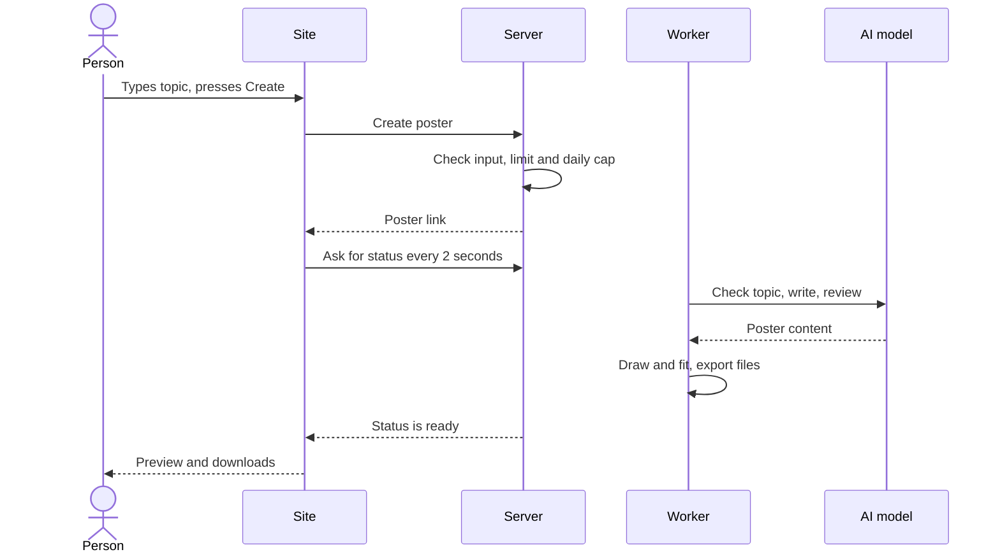
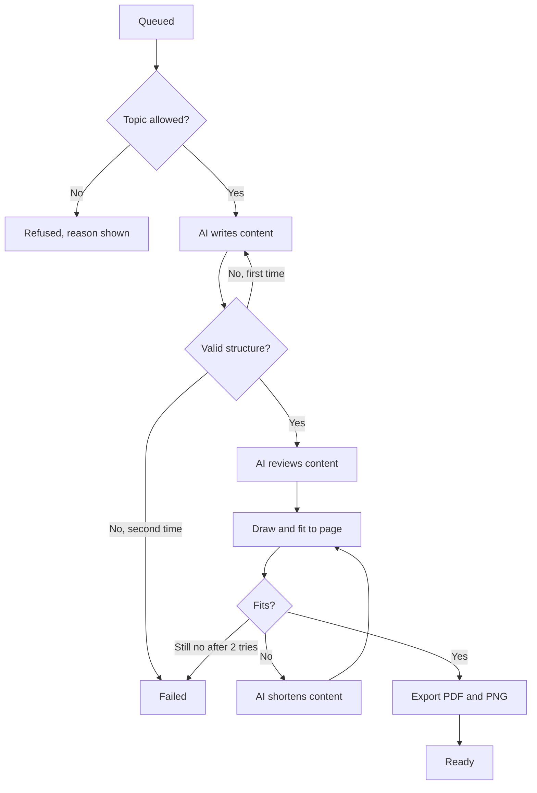
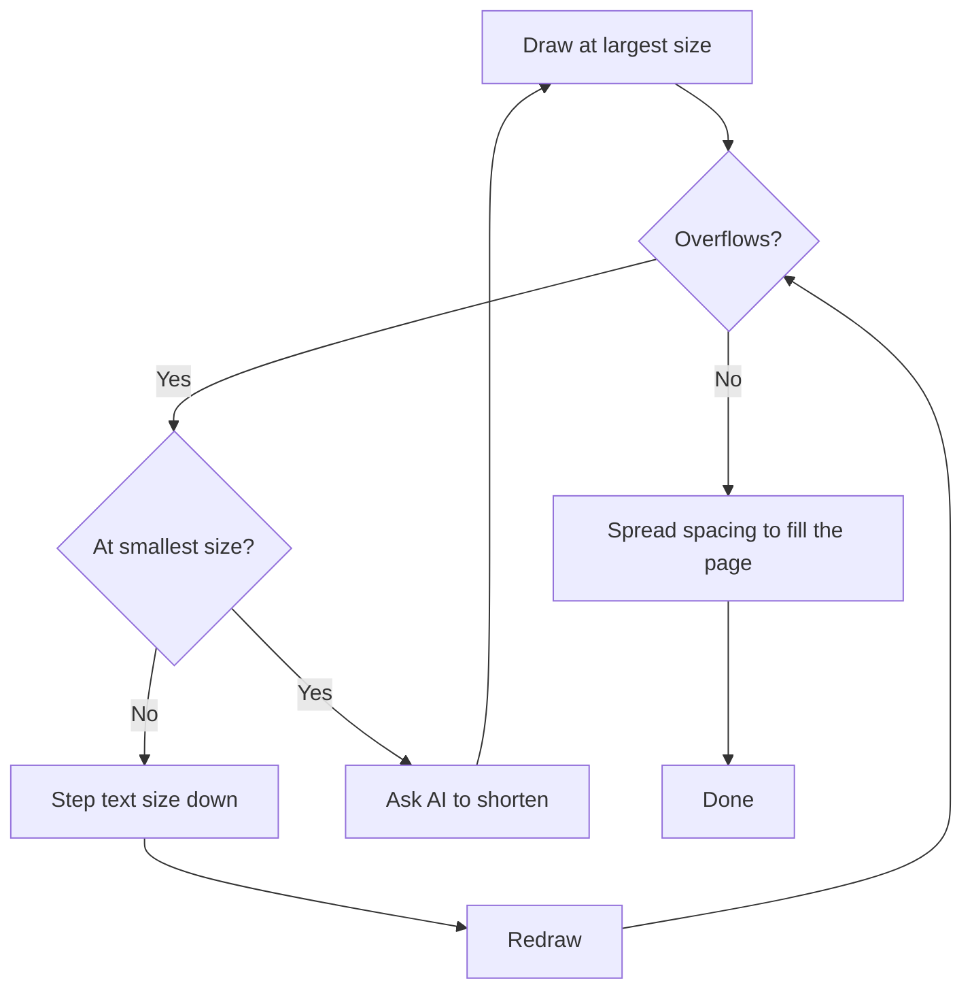
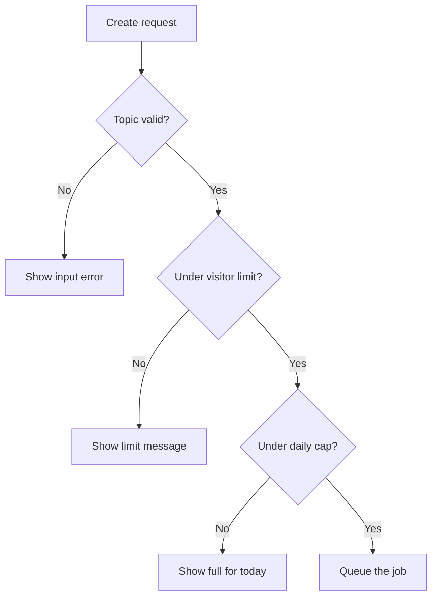
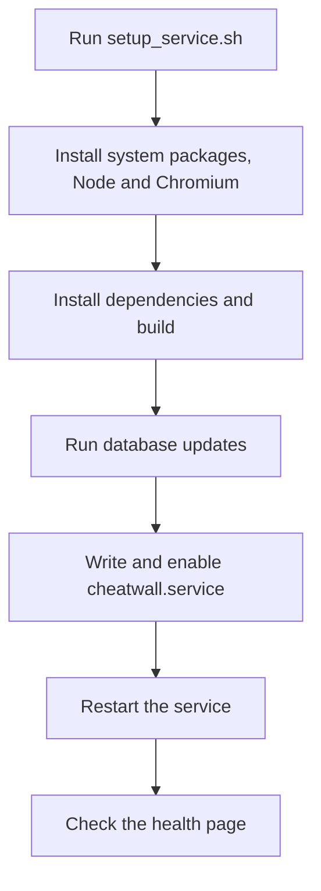

# Logical flows

These are the main flows of the first version.

## 1. Making a poster

1. You type a topic and optionally pick a level.
2. The server checks the input, your limit and the daily spend cap.
3. It saves a poster record and sends you to the poster's private link straight away.
4. A background worker does the job while the page shows progress.
5. When it's ready, the page shows the preview and download buttons.

Because the link exists from the start, you can close the tab and come back.

## 2. The job pipeline

1. **Safety check.** Is this a topic we'll make a poster for? If not, stop with a plain reason.
2. **Write.** The AI returns poster content in our structured format.
3. **Validate.** Code checks the structure. One retry if it fails.
4. **Review.** A second AI pass checks facts and fixes or removes anything shaky.
5. **Fit.** The content is drawn and fitted to the page (flow 3).
6. **Export.** PDF and PNG are saved, and the status becomes ready.

If the AI model itself declines a request, that counts as Refused. If the server restarts mid-job, the worker picks up unfinished jobs from the start of the job. Failed posters don't count against your limit.

## 3. Fitting content to the page

The poster has to fill the page, with nothing cut off and no big gaps.

1. Draw the content in the chosen template at the largest text size.
2. Measure whether it overflows.
3. Step the text size down until it fits, stopping at the smallest readable size.
4. If it still overflows, ask the AI to cut it by the measured amount.
5. If the page ends up too empty, spacing grows to fill it.

## 4. Changing the colour theme

1. You pick another theme on the poster screen.
2. The worker redraws the saved content and exports new files.
3. The preview updates.

There's no AI call, so it's free and doesn't count against your limit. The fit stays the same because themes only change colours.

## 5. Limits and the daily cap

1. A salted hash of the IP address identifies a visitor for the day. The salt changes daily.
2. Three posters a day per visitor.
3. Before each job the server compares today's spend with the cap.
4. Over the cap, the site says it's full for today and to come back tomorrow.

## 6. Opening a poster later

1. Anyone with the private link can see the poster and download it.
2. After 30 days a nightly job deletes the files and clears the content.
3. The link then shows an expired page with a button to make it again.

## 7. Setting up and updating the VM

The same script does both jobs.

